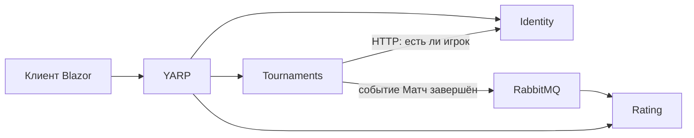
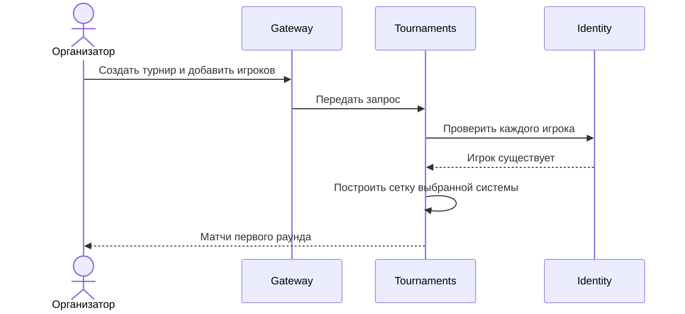
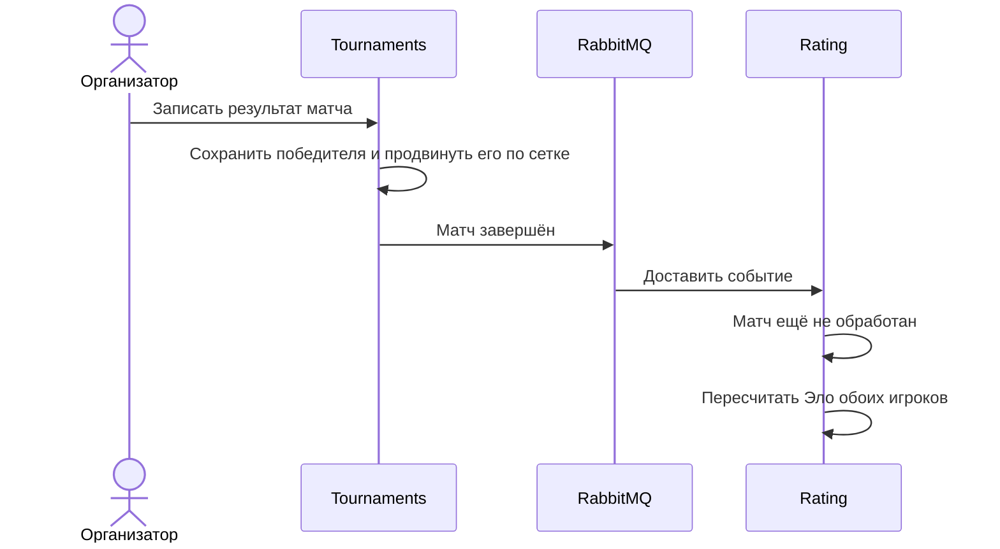
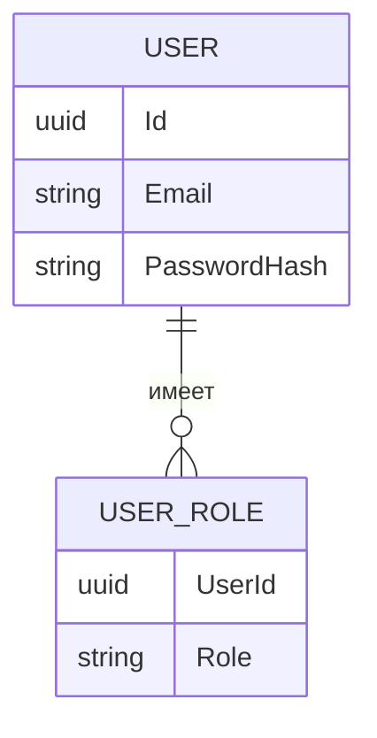
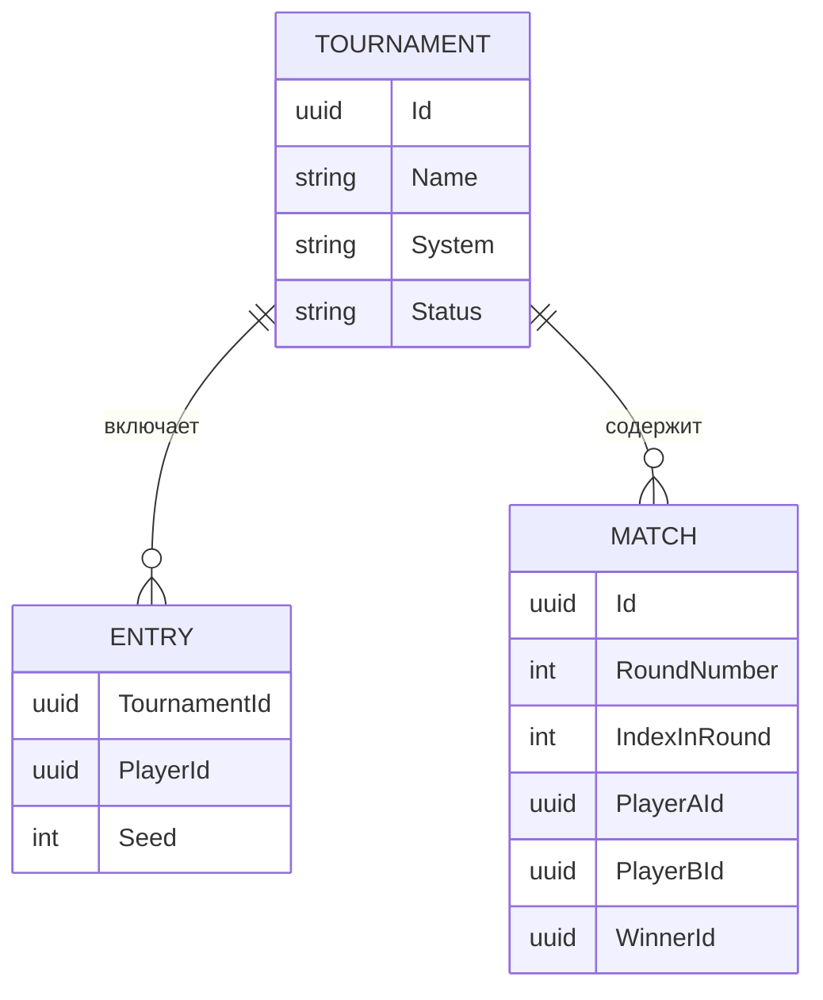
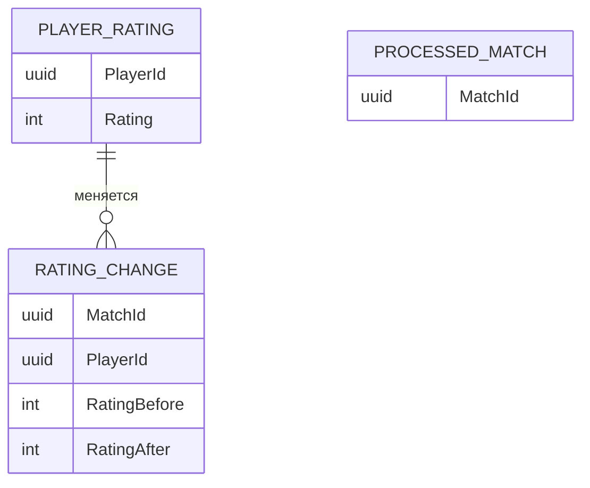

# Архитектура

Тема: турниры и рейтинги. Сетка и рейтинг считаются отдельно, чтобы турнир не менял таблицу лидеров напрямую.

Решение собирается на .NET 10.

## Сервисы

| Сервис | Что хранит у себя | С кем говорит |
| --- | --- | --- |
| Identity | Пользователь, пароль, роли | Отдаёт JWT и отвечает, существует ли игрок |
| Tournaments | Турнир, участники, матчи, сетка | Спрашивает Identity по HTTP и публикует событие в RabbitMQ |
| Rating | Рейтинг Эло и уже обработанные матчи | Читает событие и больше не обрабатывает тот же матч |
| Gateway | Ничего своего | Пропускает запросы клиента к нужному сервису |

У каждого сервиса своя база PostgreSQL. Один сервис не читает таблицы другого.

Роли задаёт Identity: игрок, организатор, администратор. Игрок записывается на турнир. Организатор создаёт турнир и вносит результат. Администратор управляет пользователями.

Событие одно: «Матч завершён». В нём есть идентификатор матча, идентификатор турнира, оба игрока и счёт первого игрока: 1, 0.5 или 0. Rating запоминает идентификатор матча. Если сообщение придёт второй раз, рейтинг не изменится.

Клиент на Blazor уже показывает вход, список турниров, сетку, запись счёта и таблицу лидеров. Лента событий в реальном времени не делалась.

## Уже написанный код

В проекте `src/Tournaments.Domain` лежат правила без базы и без HTTP:

- `EloCalculator` считает новый рейтинг;
- `RoundRobinScheduler` строит круговую сетку;
- `SingleEliminationScheduler` строит олимпийскую сетку;
- `EliminationAdvancer` записывает победителя и двигает его дальше;
- `SwissScheduler` подбирает пары по очкам без повторных встреч.

Позже сервис Tournaments вызывает эти классы. Сервис Rating использует ту же формулу Эло, когда получает событие.

## Сценарий: генерация сетки

Организатор выбирает систему: круговую, олимпийскую или швейцарскую. Для олимпийской список уже отсортирован по силе. Для швейцарской пары первого тура строятся по нулевым очкам, а следующие туры учитывают набранные очки и сыгранные пары.

## Сценарий: результат матча и рейтинг

Tournaments не знает формулу таблицы лидеров. Он только сообщает, что матч сыгран. Rating не меняет сетку.

## Данные Identity

| Сущность | Поле | Зачем |
| --- | --- | --- |
| USER | Id | Номер пользователя, его потом хранят другие сервисы |
| USER | Email | Вход в систему |
| USER | PasswordHash | Пароль хранится только в виде хэша |
| USER_ROLE | UserId | Пользователь, которому выдана роль |
| USER_ROLE | Role | Игрок, организатор или администратор |

## Данные Tournaments

| Сущность | Поле | Зачем |
| --- | --- | --- |
| TOURNAMENT | System | Круговая, олимпийская или швейцарская система |
| TOURNAMENT | Status | Набор игроков, идёт турнир или турнир завершён |
| ENTRY | PlayerId | Ссылка на пользователя из Identity, сама запись пользователя тут не хранится |
| ENTRY | Seed | Место в посеве, для олимпийской системы |
| MATCH | RoundNumber | Номер раунда |
| MATCH | IndexInRound | Номер матча внутри раунда |
| MATCH | WinnerId | Пусто, пока результат не внесён |

## Данные Rating

| Сущность | Поле | Зачем |
| --- | --- | --- |
| PROCESSED_MATCH | MatchId | Уже обработанный матч, повторное сообщение не меняет рейтинг |
| PLAYER_RATING | Rating | Текущий рейтинг Эло игрока |
| RATING_CHANGE | RatingBefore | Рейтинг до матча |
| RATING_CHANGE | RatingAfter | Рейтинг после матча |

## Что дальше

Сначала контракты HTTP для Identity, Tournaments и Rating. Потом пустые сервисы, шлюз и Docker Compose. Формулы сеток уже покрыты тестами и в эти сервисы переносятся как есть.